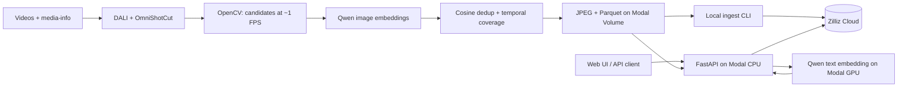

# Axis

### Semantic video search

Find moments in video using natural language, including Vietnamese. Axis extracts
representative keyframes, embeds them with **Qwen3-VL-Embedding-2B**, and retrieves
matching frames through **Zilliz Cloud**. A lightweight web UI provides image
previews and links to the original video at the matched timestamp.

<p align="center">
  
</p>

**Stack:** FastAPI · Modal · OmniShotCut · NVIDIA DALI · OpenCV · Sentence Transformers · Zilliz/Milvus

[Architecture](#architecture) · [Setup](#setup) · [Process videos](#process-videos) ·
[Ingest](#ingest-into-zilliz) · [Deploy](#deploy-the-api-and-ui) · [API](#api-reference) ·
[Configuration](#configuration) · [Benchmarks](#performance-benchmarks)

## Architecture



The offline pipeline works independently of the search service. Run it first,
ingest its output, then deploy the API and UI.

| Stage | Implementation | Runs on |
| --- | --- | --- |
| Shot detection | DALI decodes/resizes frames; OmniShotCut finds clean shot ranges | GPU |
| Candidate sampling | OpenCV sequential grab/retrieve samples roughly 1 FPS within each shot; NumPy shares RGB storage with PyTorch | CPU |
| Timing and identity | OpenCV reads presentation timestamps; SHA-256 identifies the video | CPU |
| Image embedding | Qwen encodes every candidate once, in batches of 16 | GPU |
| Frame selection | Cosine threshold **0.95**, with temporal anchors at most **5 seconds apart within each shot** | CPU |
| Export | Only retained frames become JPEGs and Parquet rows | CPU |
| Retrieval | Qwen embeds the text query; Zilliz searches by cosine similarity | Modal GPU + Zilliz |

Candidate RGB tensors remain cached in CPU RAM for export. Each embedding batch
is transferred to the model device for Qwen preprocessing and inference.
Embeddings move to CPU in native **BF16, 2048 dimensions** for selection and storage. The checkpoint
provides normalization; the pipeline does not add another normalization step.
Video pixels are decoded in two passes: DALI for detection and OpenCV for sampling.
OpenCV advances through the entire video to collect timestamps, retrieving RGB
pixels only for candidates. The capture closes before embedding; export reuses
the retained CPU tensors.

## Project structure

```text
scripts/
├── process_videos.py       # Offline Modal app and batch-processing CLI
├── serve_retrieval.py      # Deploy FastAPI CPU and Qwen GPU workers
└── benchmarks/            # Stage comparisons and alternative decoder baseline
src/
├── config.py              # Model, sampling, resource and dataset defaults
├── main.py                # FastAPI application
├── shot_detection/        # DALI preprocessing and OmniShotCut inference
├── video/                 # Sequential OpenCV sampling, timestamps and RGB cache
├── embedding/             # Qwen image and query encoding
├── keyframes/             # Selection, JPEG and Parquet export
├── pipeline/              # Single-video workflow
├── retrieval/             # Ingest, Zilliz search and preview routes
└── web/                   # Separate HTML, CSS and JavaScript files
tests/                    # Unit tests grouped by module
benchmarks/results/       # Raw benchmark measurements and optional reports
```

## Setup

### 1. Install dependencies and sign in to Modal

Requirements: **Python 3.12**, [uv](https://docs.astral.sh/uv/), a Modal account,
and a Zilliz Cloud cluster. Run commands from the repository root.

```bash
uv sync --extra pipeline --extra retrieval
uv run modal setup
```

A local GPU is not required to process videos or serve Qwen: those workloads run
on Modal. OpenCV uses the prebuilt Python wheel. The initial pipeline image build caches
Qwen weights, so it takes longer than subsequent runs.

### 2. Prepare the Modal Volume

The default Volume is **`aic-abr`**, mounted at `/workspace`. If setting up a new
workspace, create it once:

```bash
uv run modal volume create aic-abr
```

Source files must follow this layout inside the Volume:

```text
data/
├── Videos_L26_a/video/L26_V035.mp4
├── Videos_*/video/<video_id>.mp4
└── media-info-aic25-b1/media-info/<video_id>.json
```

The MP4 filename stem is the `video_id` and must be unique across input folders.
Each video needs a matching media-info JSON containing a valid `watch_url`.
Existing organizer metadata can be used directly.

Upload the complete local `data/` directory if it is not already on the Volume.
This keeps its existing folder structure under `/workspace/data`:

```bash
uv run modal volume put aic-abr ./data /data
uv run modal volume ls aic-abr data
```
Paths passed to the pipeline are relative to the Volume root, without `/workspace`.

### 3. Create the Zilliz collection

Create a collection with these **seven fields**:

| Field | Zilliz type | Meaning |
| --- | --- | --- |
| `frame_id` | `VARCHAR(128)`, primary key | Video SHA-256, video-stream ordinal and source frame index |
| `video_id` | `VARCHAR(128)` | Source filename stem |
| `frame_idx` | `INT64` | Zero-based frame index in presentation order |
| `timestamp_us` | `INT64` | OpenCV presentation timestamp in microseconds, normalized to start at zero |
| `image_uri` | `VARCHAR(1024)` | Image path relative to the dataset root |
| `watch_url` | `VARCHAR(2048)` | Original video URL from media-info |
| `embedding` | `BFLOAT16_VECTOR`, dimension `2048` | Native Qwen embedding |

Set **Auto ID off**, **Dynamic Fields off**, and fields non-nullable. Configure
`embedding` with **AUTOINDEX / COSINE**; the console's Balanced build level is a
starting point. Keep one shard and TTL disabled for the initial setup.

### 4. Configure credentials

Create `.env` in the repository root:

```dotenv
ZILLIZ_URI=https://<cluster-endpoint>
ZILLIZ_TOKEN=<api-key-or-cluster-token>
ZILLIZ_COLLECTION=<collection-name>
```

Copy the endpoint and credentials from your Zilliz cluster's connection details.
The collection name must match the collection created above. `.env` is ignored
by Git. Existing environment variables take precedence over values in this file.

## Process videos

Run one video first:

```bash
uv run modal run scripts/process_videos.py \
  --video-path data/Videos_L26_a/video/L26_V035.mp4
```

Process every MP4 recursively under `data/`:

```bash
uv run modal run scripts/process_videos.py
```

Limit discovery to one source group:

```bash
uv run modal run scripts/process_videos.py --video-dir data/Videos_L26_a
```

Outputs already present for a video cause an error. To replace them explicitly:

```bash
uv run modal run scripts/process_videos.py \
  --video-path data/Videos_L26_a/video/L26_V035.mp4 --overwrite
```

Modal distributes videos across at most **5 containers**. Each processes one
video at a time with **1 L4 GPU preferred, A10G as fallback, 4 CPU cores and
16 GiB RAM**. More videos wait in the queue; actual concurrency depends on
available GPUs and workspace quotas. The CLI prints retained-frame counts and
reports failures while allowing other videos to finish.

### Output format

Results are saved on the Modal Volume, rather than downloaded automatically:

```text
/workspace/data/retrieval/qwen2b-bf16-v1/
├── images/
│   └── L26_V035/
│       ├── 0.jpg
│       └── <source_frame_idx>.jpg
└── records/
    └── L26_V035.parquet
```

Each retained frame has exactly one JPEG and one Parquet row with the seven
fields listed above. Rejected frames produce neither. Parquet stores each BF16
vector as **4096 raw bytes** in a fixed-size binary column; ingest sends those
bytes to the collection's `BFLOAT16_VECTOR` field.

`image_uri` looks like `images/L26_V035/250.jpg`. JPEG names use source frame
indices, not sequential keyframe numbers. `watch_url` keeps the original URL;
the UI combines it with `timestamp_us` when opening YouTube.

## Ingest into Zilliz

Try one video:

```bash
uv run --extra retrieval python -m src.retrieval.ingest --video-id L26_V035
```

Ingest all exported videos:

```bash
uv run --extra retrieval python -m src.retrieval.ingest
```

This CLI runs locally, reads Parquet from the Modal Volume and upserts batches
of **128 rows**. It validates the schema and vectors, then prints the number
upserted and the collection's visible row count. It starts no GPU worker and
uploads no JPEGs to Zilliz.

| Option | Purpose |
| --- | --- |
| `--video-id L26_V035` | Select one video's Parquet shard |
| `--records-dir ./records` | Read local Parquet files instead of the Volume |
| `--batch-size 128` | Set rows per upsert request |
| `--env-file .env` | Select a credentials file |

Re-ingesting the same `frame_id` updates that record. Upsert does **not** delete
records missing from newer output. When changing the reader, batch size or selection settings, use a new
dataset version and collection, or explicitly remove obsolete records.

## Deploy the API and UI

Create the Modal Secret once from your `.env`:

```bash
uv run modal secret create aic-zilliz --from-dotenv .env
```

Deploy the retrieval app:

```bash
uv run modal deploy scripts/serve_retrieval.py
```

Modal prints the web URL. Open `/` for the UI or `/docs` for interactive API
documentation. The UI is served by FastAPI and needs no separate frontend build.
Redeploy the same script after changing API code, UI files or deployment settings.

The **`aic-retrieval`** app contains a CPU web function and a separate Qwen GPU
worker. The web function reads previews from the Volume and uses the `aic-zilliz`
Secret to connect to Zilliz. Qwen loads once per GPU container and scales to zero
after 60 idle seconds; the next query may wait for a cold start.

### Local development

After deploying the Qwen worker, run FastAPI locally:

```bash
uv run --extra retrieval uvicorn src.main:app --reload
```

Open `http://127.0.0.1:8000`. Query embedding still runs on Modal, so local Modal
credentials and a deployed `aic-retrieval` app are required.

For local image previews, download the dataset and point `DATASET_ROOT` at the
directory containing `images/` and `records/`:

```bash
uv run modal volume get aic-abr \
  data/retrieval/qwen2b-bf16-v1 ./local-dataset
DATASET_ROOT=./local-dataset \
  uv run --extra retrieval uvicorn src.main:app --reload
```

## API reference

| Method | Route | Purpose |
| --- | --- | --- |
| `GET` | `/` | Search UI |
| `GET` | `/docs` | Swagger UI |
| `GET` | `/health` | Basic app health; does not run model inference |
| `POST` | `/search` | Text-to-keyframe retrieval |
| `GET` | `/frames/{video_id}/{frame_idx}.jpg` | Retained JPEG preview |

Example search; replace the URL with your deployment URL:

```bash
curl -X POST 'https://<deployment-url>/search' \
  -H 'Content-Type: application/json' \
  -d '{"query":"Một đàn sư tử đang nghỉ ngơi và leo trèo trên các bục gỗ trong khu nuôi dưỡng, phía trước có bảng thông tin của London Zoo phục vụ công tác theo dõi và bảo tồn động vật.", "top_k":20}'
```

`top_k` defaults to **20** and accepts **1–100**. Optionally add
`"video_id":"L26_V035"` to restrict results to one video.

The response contains `query` and a `results` array. Each hit includes
`frame_id`, `video_id`, `frame_idx`, `timestamp_us`, `image_uri`, `watch_url`,
`score` and `image_url`. Results are ordered by cosine similarity; `score` is
not a probability. Embeddings are not returned to the browser.

## Configuration

Edit [`src/config.py`](src/config.py) for shared defaults:

| Setting | Default | Purpose |
| --- | --- | --- |
| `PIPELINE_GPU` | `["L4", "A10G"]` | Preferred GPU and fallback for offline processing |
| `QUERY_GPU` | `["L4", "A10G"]` | Preferred GPU and fallback for query embedding |
| `CPU_CORES` / `MEMORY_MIB` | `4` / `16384` | Resources per pipeline worker |
| `MAX_CONTAINERS` | `5` | Maximum concurrent pipeline workers |
| `BATCH_SIZE` | `16` | Candidate embedding batch size |
| `SIMILARITY_THRESHOLD` | `0.95` | Within-shot cosine deduplication cutoff |
| `MAX_GAP_SECONDS` | `5` | Maximum within-shot temporal coverage gap |
| `MAX_PIXELS` | `524288` | Maximum candidate image pixels for Qwen preprocessing |
| `JPEG_QUALITY` | `95` | Retained JPEG quality |
| `SCALEDOWN_WINDOW` | `2 seconds` | Pipeline worker idle window before scale-down |
| `MAX_FRAME_CACHE_BYTES` | `8 GiB` | Candidate RGB cache limit in CPU RAM |
| `DATASET_VERSION` | `qwen2b-bf16-v1` | Output dataset directory |
| `VOLUME_NAME` | `aic-abr` | Source and output Volume |

The model ID and revision are pinned in the same file so image and query
embeddings use the same checkpoint. Query-worker CPU/RAM and API resources are
configured separately in `scripts/serve_retrieval.py`.

### Current limits

- The reader uses OpenCV's default first video stream (video-stream ordinal 0).
- Timestamps must increase; missing or unsupported timestamp sequences fail explicitly.
- The final frame endpoint is estimated from average FPS, rather than exact packet duration.
- Candidate decoding uses sequential OpenCV on CPU; shot detection still requires DALI GPU decoding.
- DALI holds the resized detection video on GPU, and OpenCV retains candidate RGB
  tensors in CPU RAM. Long or high-resolution videos can exceed memory/cache limits.
- Coverage applies within detected clean shots; gaps across shot boundaries can exceed 5 seconds.

## Performance benchmarks

The evaluation compares the pipeline's DALI preprocessing, sequential OpenCV
sampling and batch-16 embedding with alternative implementations.
Each experiment changes one stage: preparing frames for shot detection, reading
candidate images, or grouping images for embedding. The other stages are outside
that experiment's timer, so the three speedups should not be added together.

### Dataset and measurement setup

The benchmark uses **15 randomly selected videos from 873 source MP4 videos**
in the source dataset. The full source corpus contains:

- **Total duration:** 470,430.73 seconds (**130 hours 40 minutes 31 seconds**).
- **Total file size:** 82,984,040,674 bytes (**82.98 GB / 77.28 GiB**).

The 15-video benchmark sample contains:

- **Total duration:** 12,136.28 seconds (**3 hours 22 minutes 16 seconds**).
- **Total file size:** 1,702,082,786 bytes (**1.70 GB / 1.59 GiB**).
- **Video duration range:** 35.34 seconds to 28 minutes 56 seconds.

Counts and file sizes for both the full corpus and sample were checked against
the local source dataset; all 873 durations were measured with FFprobe.
Sample IDs are recorded in the raw benchmark
results; a random-selection seed was not recorded.

Measured on **2026-11-08** across these **15 videos** using Modal **A10G**,
with **4 CPU cores and 16 GiB RAM per worker**, up to five workers per script.
Every configuration completed one measured run per video without errors or OOM.
The tables sum measured stage times across videos; they exclude queueing, model
loading and warmup, and do not represent full-pipeline time or elapsed batch time.

### DALI preprocessing for shot detection

Shot detection examines every video frame and returns frame ranges representing
clean shots. This experiment compares two ways of preparing those frames for the
same OmniShotCut checkpoint:

- **DALI path (pipeline):** DALI decodes and resizes frames on GPU. PyTorch reads
  the resized GPU buffers through DLPack, normalizes inference windows on GPU,
  and passes them to OmniShotCut without a full-video round trip through CPU RAM.
- **Official video-path API:** `model.inference(video_path, mode="clean_shot")`
  lets OmniShotCut decode and resize using FFmpeg on CPU. Frames are held as
  NumPy arrays, transformed on CPU in inference windows, then transferred to
  GPU for the same model inference.

Both paths use the same model resolution and overlapping-window setting. The
first timing column measures decode/resize; the total also includes window
preprocessing, transfers, model inference and assembling the detected shots.

| Shot detection path | Decode + resize | Total shot detection |
| --- | ---: | ---: |
| **Current DALI path** | **279.19 s** | **356.88 s** |
| Official OmniShotCut video-path API | 288.04 s | 407.58 s |

The current path reduced total shot-detection time by **12.4%**. This includes
window preprocessing, transfer, inference and shot assembly, so the entire gain
cannot be attributed to decode/resize alone. Frame counts matched on all videos,
but exact clean-shot ranges matched on only **3 of 15 videos**. The two paths
therefore have observable output differences; this is not an accuracy benchmark.

### Candidate reading: sequential OpenCV vs alternatives

After shot detection, the pipeline needs only a subset of full-resolution frames
for embedding, roughly one per second within each shot. This experiment gives
each reader the same candidate frame indices and compares how it retrieves them:

- **OpenCV sequential (pipeline strategy):** Open the video once and advance
  forward with `grab()`. Call `retrieve()` only at requested indices, convert
  OpenCV's BGR images to RGB and retain CPU tensors. Intermediate frames still
  require decoder work, but do not need an RGB image returned to Python.
- **OpenCV seek:** For each requested index, call
  `set(CAP_PROP_POS_FRAMES, index)` followed by `read()`, then convert to RGB and
  retain the image. Seeking in compressed video can repeatedly decode from a
  preceding keyframe, including frames already traversed for another candidate.
- **PyAV + Decord CPU:** PyAV demuxes packets to build a presentation-timestamp
  timeline. Decord indexes and validates the video, then `get_batch()` retrieves
  requested frames in groups of four, retaining RGB tensors on CPU.

The metadata/indexing column includes source SHA-256 hashing in every variant.
Sampling includes obtaining and retaining all candidate RGB tensors; shot
detection and embedding are excluded.

| Candidate reading path | Metadata/indexing | Sampling | Total |
| --- | ---: | ---: | ---: |
| **OpenCV sequential** | **1.86 s** | **225.11 s** | **226.97 s** |
| PyAV + Decord CPU | 7.81 s | 225.51 s | 233.32 s |
| OpenCV seek | 1.85 s | 688.48 s | 690.33 s |

**OpenCV sequential was the fastest reader in this run:** it reduced total
reading time by **2.7%** compared with PyAV + Decord CPU and **67.1%**
compared with OpenCV seek (3.04× speedup). Metadata work differs:
PyAV/Decord builds and validates the exact presentation timeline, while OpenCV
reads basic properties.
Sparse RGB probes matched for all videos, reported frame positions matched, and
OpenCV candidate timestamps differed from the reference by less than 1 microsecond.
These checks do not establish exhaustive pixel or timestamp equivalence. The
OpenCV benchmark uses candidate indices prepared outside timing and stops at the
last candidate. Production additionally builds the timestamp timeline while
scanning to EOF, so 226.97 seconds is not a measurement of the complete production reader.

### Embedding batch size

This experiment keeps the Qwen checkpoint, image-resolution settings, candidate
order and **12,799 candidate images** fixed. Only the number of images passed to
each encode call changes:

- **Batch 1:** Transfer, preprocess and encode one image per call.
- **Batches 2, 4, 8 and 16:** Process that many images together per call, with a
  smaller final batch when necessary. Larger batches can amortize per-call
  overhead and increase GPU utilization, while requiring more GPU memory.

The pipeline uses batch 16. Candidate decoding is completed and images are cached
in CPU RAM before timing. Every configuration measures the same sequence of
steps: transfer a batch to GPU, preprocess images, encode them with Qwen, and
return embeddings to CPU. No images are dropped or reused as cached embeddings.

| Batch size | Total embedding time | Reduction vs batch 1 |
| --- | ---: | ---: |
| 1 | 1,239.49 s | — |
| 2 | 1,120.91 s | 9.6% |
| 4 | 1,041.65 s | 16.0% |
| 8 | 1,017.88 s | 17.9% |
| **16 (pipeline default)** | **994.07 s** | **19.8%** |

Batch 16 was fastest among the tested sizes, reducing time by another **4.6%**
relative to batch 4. All sizes completed without OOM and passed the benchmark's
embedding similarity check against batch 4 (per-frame cosine similarity at least
0.995); embeddings are not bit-identical across batch sizes. The production batch
size is 16.

These single-run measurements support the benefits of the DALI path and batching,
but small differences may reflect run-to-run variation. They do not prove a global
optimum or the absence of pipeline bottlenecks. Time reduction is calculated as
`(baseline_time - candidate_time) / baseline_time * 100`.

Raw results: [DALI](benchmarks/results/dali.json),
[candidate reading](benchmarks/results/opencv.json),
[batch sizes](benchmarks/results/batch-all.json).

### Reproduce the benchmarks

These scripts compare the DALI path with the standard OmniShotCut video-path
API, PyAV + Decord CPU with OpenCV (sequential and seeking), and embedding batch sizes
1, 2, 4, 8 and 16. Each benchmark covers every source video on the Volume with
one measured run per configuration by default. They use up to five GPU workers per
benchmark, each with 4 CPU cores and 16 GiB RAM; production artifacts are not overwritten.
The GPU defaults to A10G for all three scripts. Set `BENCHMARK_GPU` consistently
if changing hardware. Use `--video-path` to limit a run to one video.

```bash
uv run --extra pipeline modal run scripts/benchmarks/benchmark_dali.py
uv run --extra pipeline --extra benchmark modal run scripts/benchmarks/benchmark_opencv.py
uv run --extra pipeline modal run scripts/benchmarks/benchmark_batch.py

# Optional: generate a report after all three finish.
uv run python scripts/benchmarks/summarize.py --min-repeats 1
```

Run the scripts sequentially to limit concurrent GPU demand to five workers.
Running all three simultaneously can request up to 15 GPU workers and hit
workspace limits.

The decoder comparison implements the PyAV/Decord alternative in
`scripts/benchmarks/legacy_video.py`; those dependencies belong to the optional
`benchmark` extra and are not used by production sampling. Embedding benchmarks use the OpenCV candidate reader.

All three scripts follow the production dispatch pattern: list source videos,
then use Modal `.map()` with at most five workers. Each video stays on one
worker for its paired comparisons. Candidate benchmarks prepare shot ranges
outside their timed sections when cached ranges are unavailable.
Results are saved under `benchmarks/results/` locally and separate `benchmarks/`
directories on the Volume. The summary produces JSON, per-video CSV and an HTML
report. It compares sums of per-video median stage times, excluding model load
and warmup; these are not full-pipeline times or concurrent batch makespans.
OpenCV reads basic metadata while PyAV/Decord validates exact timestamps, so
consider correctness diagnostics alongside speed. Configurations with OOM or
incomplete repetitions do not receive an all-video speedup claim. A single run
is exploratory; increase repeats when assessing measurement stability.

## Development checks

```bash
uv run --extra pipeline --extra retrieval pytest -q
uv run ruff check src tests
```

Manage dependencies with `uv add` / `uv remove` and commit the updated `uv.lock`.
For example:

```bash
uv add --optional retrieval <package>
```
