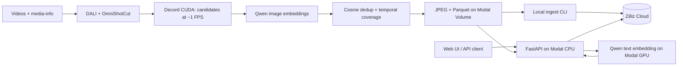

# Axis

### Semantic video search

Find moments in video using natural language, including Vietnamese. Axis extracts
representative keyframes, embeds them with **Qwen3-VL-Embedding-2B**, and retrieves
matching frames through **Zilliz Cloud**. A lightweight web UI provides image
previews and links to the original video at the matched timestamp.

<video src="https://github.com/24520152-ben/Axis-Semantic-Video-Search/blob/main/assets/demo.mp4" autoplay loop muted playsinline width="100%"></video>

**Stack:** FastAPI · Modal · OmniShotCut · NVIDIA DALI · Decord CUDA · Sentence Transformers · Zilliz/Milvus

[Architecture](#architecture) · [Setup](#setup) · [Process videos](#process-videos) ·
[Ingest](#ingest-into-zilliz) · [Deploy](#deploy-the-api-and-ui) · [API](#api-reference) ·
[Configuration](#configuration)

## Architecture



The offline pipeline works independently of the search service. Run it first,
ingest its output, then deploy the API and UI.

| Stage | Implementation | Runs on |
| --- | --- | --- |
| Shot detection | DALI decodes/resizes frames; OmniShotCut finds clean shot ranges | GPU |
| Candidate sampling | Decord CUDA samples roughly 1 FPS within each shot; DLPack passes tensors to PyTorch | GPU |
| Timing and identity | PyAV demux reads source timestamps; SHA-256 identifies the video | CPU |
| Image embedding | Qwen encodes every candidate once, in batches of 4 | GPU |
| Frame selection | Cosine threshold **0.95**, with temporal anchors at most **5 seconds apart within each shot** | CPU |
| Export | Only retained frames become JPEGs and Parquet rows | CPU |
| Retrieval | Qwen embeds the text query; Zilliz searches by cosine similarity | Modal GPU + Zilliz |

Candidate RGB tensors remain cached on GPU for export. Embeddings move to CPU
in native **BF16, 2048 dimensions** for selection and storage. The checkpoint
provides normalization; the pipeline does not add another normalization step.
Video pixels are decoded in two passes: DALI for detection and Decord for sampling.

## Project structure

```text
scripts/
├── process_videos.py       # Offline Modal app and batch-processing CLI
├── serve_retrieval.py      # Deploy FastAPI CPU and Qwen GPU workers
└── build_decord.sh         # Build CUDA-enabled Decord in the Modal image
src/
├── config.py              # Model, sampling, resource and dataset defaults
├── main.py                # FastAPI application
├── shot_detection/        # DALI preprocessing and OmniShotCut inference
├── video/                 # Source metadata, timestamps and Decord reader
├── embedding/             # Qwen image and query encoding
├── keyframes/             # Selection, JPEG and Parquet export
├── pipeline/              # Single-video workflow
├── retrieval/             # Ingest, Zilliz search and preview routes
└── web/                   # Separate HTML, CSS and JavaScript files
tests/                    # Unit tests grouped by module
```

## Setup

### 1. Install dependencies and sign in to Modal

Requirements: **Python 3.12**, [uv](https://docs.astral.sh/uv/), a Modal account,
and a Zilliz Cloud cluster. Run commands from the repository root.

```bash
uv sync --extra pipeline --extra retrieval
uv run modal setup
```

A local GPU is not required to process videos or serve Qwen: those workloads run
on Modal. The initial pipeline image build compiles Decord with CUDA and caches
Qwen weights, so it takes longer than subsequent runs.

### 2. Prepare the Modal Volume

The default Volume is **`aic-abr`**, mounted at `/workspace`. If setting up a new
workspace, create it once:

```bash
uv run modal volume create aic-abr
```

Source files must follow this layout inside the Volume:

```text
data/
├── Videos_L26_a/video/L26_V035.mp4
├── Videos_*/video/<video_id>.mp4
└── media-info-aic25-b1/media-info/<video_id>.json
```

The MP4 filename stem is the `video_id` and must be unique across input folders.
Each video needs a matching media-info JSON containing a valid `watch_url`.
Existing organizer metadata can be used directly.

Upload the complete local `data/` directory if it is not already on the Volume.
This keeps its existing folder structure under `/workspace/data`:

```bash
uv run modal volume put aic-abr ./data /data
uv run modal volume ls aic-abr data
```
Paths passed to the pipeline are relative to the Volume root, without `/workspace`.

### 3. Create the Zilliz collection

Create a collection with these **seven fields**:

| Field | Zilliz type | Meaning |
| --- | --- | --- |
| `frame_id` | `VARCHAR(128)`, primary key | Video SHA-256, stream index and source frame index |
| `video_id` | `VARCHAR(128)` | Source filename stem |
| `frame_idx` | `INT64` | Zero-based frame index in presentation order |
| `timestamp_us` | `INT64` | Source timestamp in microseconds, normalized to start at zero |
| `image_uri` | `VARCHAR(1024)` | Image path relative to the dataset root |
| `watch_url` | `VARCHAR(2048)` | Original video URL from media-info |
| `embedding` | `BFLOAT16_VECTOR`, dimension `2048` | Native Qwen embedding |

Set **Auto ID off**, **Dynamic Fields off**, and fields non-nullable. Configure
`embedding` with **AUTOINDEX / COSINE**; the console's Balanced build level is a
starting point. Keep one shard and TTL disabled for the initial setup.

### 4. Configure credentials

Create `.env` in the repository root:

```dotenv
ZILLIZ_URI=https://<cluster-endpoint>
ZILLIZ_TOKEN=<api-key-or-cluster-token>
ZILLIZ_COLLECTION=<collection-name>
```

Copy the endpoint and credentials from your Zilliz cluster's connection details.
The collection name must match the collection created above. `.env` is ignored
by Git. Existing environment variables take precedence over values in this file.

## Process videos

Run one video first:

```bash
uv run modal run scripts/process_videos.py \
  --video-path data/Videos_L26_a/video/L26_V035.mp4
```

Process every MP4 recursively under `data/`:

```bash
uv run modal run scripts/process_videos.py
```

Limit discovery to one source group:

```bash
uv run modal run scripts/process_videos.py --video-dir data/Videos_L26_a
```

Outputs already present for a video cause an error. To replace them explicitly:

```bash
uv run modal run scripts/process_videos.py \
  --video-path data/Videos_L26_a/video/L26_V035.mp4 --overwrite
```

Modal distributes videos across at most **5 containers**. Each processes one
video at a time with **1 L4 GPU preferred, A10G as fallback, 4 CPU cores and
16 GiB RAM**. More videos wait in the queue; actual concurrency depends on
available GPUs and workspace quotas. The CLI prints retained-frame counts and
reports failures while allowing other videos to finish.

### Output format

Results are saved on the Modal Volume, rather than downloaded automatically:

```text
/workspace/data/retrieval/qwen2b-bf16-v1/
├── images/
│   └── L26_V035/
│       ├── 0.jpg
│       └── <source_frame_idx>.jpg
└── records/
    └── L26_V035.parquet
```

Each retained frame has exactly one JPEG and one Parquet row with the seven
fields listed above. Rejected frames produce neither. Parquet stores each BF16
vector as **4096 raw bytes** in a fixed-size binary column; ingest sends those
bytes to the collection's `BFLOAT16_VECTOR` field.

`image_uri` looks like `images/L26_V035/250.jpg`. JPEG names use source frame
indices, not sequential keyframe numbers. `watch_url` keeps the original URL;
the UI combines it with `timestamp_us` when opening YouTube.

## Ingest into Zilliz

Try one video:

```bash
uv run --extra retrieval python -m src.retrieval.ingest --video-id L26_V035
```

Ingest all exported videos:

```bash
uv run --extra retrieval python -m src.retrieval.ingest
```

This CLI runs locally, reads Parquet from the Modal Volume and upserts batches
of **128 rows**. It validates the schema and vectors, then prints the number
upserted and the collection's visible row count. It starts no GPU worker and
uploads no JPEGs to Zilliz.

| Option | Purpose |
| --- | --- |
| `--video-id L26_V035` | Select one video's Parquet shard |
| `--records-dir ./records` | Read local Parquet files instead of the Volume |
| `--batch-size 128` | Set rows per upsert request |
| `--env-file .env` | Select a credentials file |

Re-ingesting the same `frame_id` updates that record. Upsert does **not** delete
records missing from newer output. When changing selection settings, use a new
dataset version and collection, or explicitly remove obsolete records.

## Deploy the API and UI

Create the Modal Secret once from your `.env`:

```bash
uv run modal secret create aic-zilliz --from-dotenv .env
```

Deploy the retrieval app:

```bash
uv run modal deploy scripts/serve_retrieval.py
```

Modal prints the web URL. Open `/` for the UI or `/docs` for interactive API
documentation. The UI is served by FastAPI and needs no separate frontend build.
Redeploy the same script after changing API code, UI files or deployment settings.

The **`aic-retrieval`** app contains a CPU web function and a separate Qwen GPU
worker. The web function reads previews from the Volume and uses the `aic-zilliz`
Secret to connect to Zilliz. Qwen loads once per GPU container and scales to zero
after 60 idle seconds; the next query may wait for a cold start.

### Local development

After deploying the Qwen worker, run FastAPI locally:

```bash
uv run --extra retrieval uvicorn src.main:app --reload
```

Open `http://127.0.0.1:8000`. Query embedding still runs on Modal, so local Modal
credentials and a deployed `aic-retrieval` app are required.

For local image previews, download the dataset and point `DATASET_ROOT` at the
directory containing `images/` and `records/`:

```bash
uv run modal volume get aic-abr \
  data/retrieval/qwen2b-bf16-v1 ./local-dataset
DATASET_ROOT=./local-dataset \
  uv run --extra retrieval uvicorn src.main:app --reload
```

## API reference

| Method | Route | Purpose |
| --- | --- | --- |
| `GET` | `/` | Search UI |
| `GET` | `/docs` | Swagger UI |
| `GET` | `/health` | Basic app health; does not run model inference |
| `POST` | `/search` | Text-to-keyframe retrieval |
| `GET` | `/frames/{video_id}/{frame_idx}.jpg` | Retained JPEG preview |

Example search; replace the URL with your deployment URL:

```bash
curl -X POST 'https://<deployment-url>/search' \
  -H 'Content-Type: application/json' \
  -d '{"query":"Một đàn sư tử đang nghỉ ngơi và leo trèo trên các bục gỗ trong khu nuôi dưỡng, phía trước có bảng thông tin của London Zoo phục vụ công tác theo dõi và bảo tồn động vật.", "top_k":20}'
```

`top_k` defaults to **20** and accepts **1–100**. Optionally add
`"video_id":"L26_V035"` to restrict results to one video.

The response contains `query` and a `results` array. Each hit includes
`frame_id`, `video_id`, `frame_idx`, `timestamp_us`, `image_uri`, `watch_url`,
`score` and `image_url`. Results are ordered by cosine similarity; `score` is
not a probability. Embeddings are not returned to the browser.

## Configuration

Edit [`src/config.py`](src/config.py) for shared defaults:

| Setting | Default | Purpose |
| --- | --- | --- |
| `PIPELINE_GPU` | `["L4", "A10G"]` | Preferred GPU and fallback for offline processing |
| `QUERY_GPU` | `["L4", "A10G"]` | Preferred GPU and fallback for query embedding |
| `CPU_CORES` / `MEMORY_MIB` | `4` / `16384` | Resources per pipeline worker |
| `MAX_CONTAINERS` | `5` | Maximum concurrent pipeline workers |
| `BATCH_SIZE` | `4` | Candidate embedding batch size |
| `SIMILARITY_THRESHOLD` | `0.95` | Within-shot cosine deduplication cutoff |
| `MAX_GAP_SECONDS` | `5` | Maximum within-shot temporal coverage gap |
| `MAX_FRAME_CACHE_BYTES` | `8 GiB` | Candidate RGB cache limit |
| `DATASET_VERSION` | `qwen2b-bf16-v1` | Output dataset directory |
| `VOLUME_NAME` | `aic-abr` | Source and output Volume |

The model ID and revision are pinned in the same file so image and query
embeddings use the same checkpoint. Query-worker CPU/RAM and API resources are
configured separately in `scripts/serve_retrieval.py`.

### Current limits

- The reader requires one video stream with timestamps matching Decord's frame indexing.
- Unsupported GPU decoding fails explicitly; there is no CPU decode fallback.
- DALI holds the resized detection video on GPU, and Decord caches candidate RGB
  tensors. Long or high-resolution videos can exceed memory/cache limits.
- Coverage applies within detected clean shots; gaps across shot boundaries can exceed 5 seconds.

## Development checks

```bash
uv run --extra pipeline --extra retrieval pytest -q
uv run ruff check src tests
```

Manage dependencies with `uv add` / `uv remove` and commit the updated `uv.lock`.
For example:

```bash
uv add --optional retrieval <package>
```
